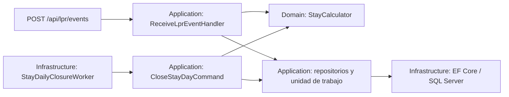

# DESIGN-004 — Entradas, salidas y estancias

| Campo | Valor |
| --- | --- |
| Requerimiento | [RF-004](../requirements/RF-004-arrivals-departures-and-stays.md), prioridad Alta |
| Estado | P004-01 a P004-03 resueltas; backend implementado y verificado; límites en TASKS-004 / 19 |
| Fecha | 16 de noviembre de 2026; decisiones completadas el 17 de noviembre de 2026 |
| Plataforma | C# 14, .NET 10, ASP.NET Core, EF Core y SQL Server |
| Dependencias | RF-002, RF-003 y RF-009; consultas posteriores en RF-005 y correcciones en RF-006 |
| Plan | [TASKS-004](../tasks/TASKS-004-arrivals-departures-and-stays.md), entrega y verificación del backend en secciones 18 y 19 |

## 1. Alcance y base inspeccionada

RN y CA pertenecen a RF-004 salvo indicación expresa. Se diseñan el cálculo de
estancias, su persistencia síncrona con la ingesta, el cierre diario recuperable,
la conservación del rastro y la ubicación descriptiva de dispositivos. No se
añaden endpoints de historial, correcciones, imágenes ni panel.

La base actual contiene:

| Componente existente | Integración prevista |
| --- | --- |
| `ReceiveLprEventHandler` | Mantener autorización, comparación de reintentos y ventana de captura; incorporar cálculo antes del commit de un evento nuevo. |
| `ILprUnitOfWork` / `LprUnitOfWork` | Reutilizar la transacción de ingesta; extender coordinación con la partición vehículo/taller sin transacciones anidadas. |
| `SqlTransactions` | Conservar `Serializable`, bloqueo transaccional, rollback de resultados fallidos y distinción de commit incierto. |
| `AuthenticationDbContext` | Añadir mappings y DbSets de estancias, políticas, asociaciones, ubicación y planificación. No renombrar el contexto como parte de este trabajo. |
| `LprEventRow`, `LprEvents` | Mantener eventos originales inmutables, PK global y comparación semántica de RF-003. |
| `LprDevice`, `DeviceDto`, administración y auditoría | Incorporar ubicación de forma compatible y mantener su historia fuera de la retención limitada de auditoría administrativa. |
| `ILprClock` | Obtener un instante UTC compartido dentro de cada transacción; en pruebas usar reloj determinista. |

La implementación actual bloquea `workshops:catalog` en modo exclusivo antes
de dispositivo y evento. Esto serializa más tráfico que una partición por
vehículo; RF-004 no cambia esa política transversal sin medición y revisión.
La nueva partición asegura que ingesta y cierre diario compartan coordinación,
también si posteriormente se reduce la contención del bloqueo de catálogo.

## 2. Arquitectura y contratos internos



### 2.1. Domain

Nuevo espacio `GarajeMetria.Domain.Stays`, sin paquetes, consultas ni reloj del
sistema. Tipos previstos:

- `VehicleStay`: identidad, extremos, procedencia, estado y política inmutable.
- `StayPolicySnapshot`: X, intervalo de repetición, máximo de asociación,
  zona horaria y versión de algoritmo.
- `StayObservation`: proyección inmutable de los campos necesarios de un evento;
  no vuelve a clasificar matrículas con reglas más recientes.
- `ObservationGroup`: observaciones equivalentes y representantes de entrada/salida.
- `StayCalculator`: función determinista que recibe observaciones ordenadas,
  contexto previo, políticas históricas, instante actual y días ya terminados;
  devuelve candidatos y asociaciones con razones explícitas.
- `StayBoundarySource`: `Explicit`, `Inferred`, `Estimated`.
- `StayState`: `Open`, `PendingEntry`, `ClosedProvisional`.

T004-02 implementa `VehicleStay`, `StayPolicySnapshot`, `StayObservation`,
`StayBoundary` y los enums de estado/fuente. `StayBoundary` vincula el instante
observado a su observación y representa una estimación sin evento. El agregado
mantiene política/ancla/creación/orden inmutables y ofrece `ReviseBoundaries`
con validación atómica y no-op. Valida contexto, dirección explícita y duración X
histórica de las estimaciones; T004-04 incorpora interpretación explícita
y T004-05 asociación sin dirección y fallback diario. `Duration` no almacena
tiempo creciente y `GetDurationAt` requiere
instante suministrado; devuelve null si aún no alcanzó una captura futura.
No determina por ello el contrato de consulta RF-005. Evidencia en TASKS-004 / 11.

Un cierre estimado sigue siendo `ClosedProvisional`: una salida posterior puede
reemplazarlo. No introducir un estado «definitivo» que impida RN-026. Para una
salida pendiente, `EntryAt` es null; para una abierta, `ExitAt` es null. Con ambos
extremos la duración es su diferencia UTC. No persistir una duración creciente
para estancias abiertas.

Invariantes: taller y matrícula coherentes, política positiva y completa,
instantes UTC, salida mayor o igual que entrada cuando ambas existen,
referencia a observación para extremos explícitos o inferidos y ausencia de esa
referencia para extremos estimados. Una estimación no es un `LprEvent`.

### 2.2. Application

| Contrato propuesto | Responsabilidad |
| --- | --- |
| `IStayObservationQuery` | Leer páginas materializadas y contexto de borde por taller/matrícula/intervalo, incluida ubicación; sin `IQueryable`. |
| `IStayRepository` | Obtener contexto persistido y aplicar un conjunto de cambios de estancias y asociaciones dentro de la transacción activa. |
| `IStayPolicyRepository` | Resolver la versión activa y las instantáneas históricas, sin cambiar la política de una estancia existente. |
| `IStayClosureRepository` | Seleccionar trabajo vencido con paginación, comprobar cierre y actualizar progreso atómicamente. |
| `IStayClosureUnitOfWork` | Ejecutar un cierre de partición sin identidad ficticia de dispositivo y con el mismo orden de bloqueos que la ingesta. |
| `IWorkshopCalendar` | Convertir instantes en fecha local y proporcionar límites UTC de cada día `Atlantic/Canary`. La implementación de zona horaria vive en Infrastructure. |
| `StayRecalculationService` | Orquestación interna compartida por ingesta y cierre, sin iniciar ni confirmar otra transacción. |

`CloseStayDayCommand` es un comando MediatR interno con fecha local y partición
persistida. No implementa `ILprAdministrationRequest` ni usa un usuario simulado.
Su validador comprueba identificadores y que el día haya terminado con el reloj
compartido; no expone operación HTTP ni permite cerrar días futuros.

La ingesta continúa entrando por `ReceiveLprEventCommand` y sus behaviors de
autorización y validación. El servicio de recálculo recibe entradas ya validadas
y no constituye un segundo caso de uso público que omita validación.

### 2.3. Infrastructure y Api

Entrega contractual T004-07: `Application/Stays` contiene los puertos anteriores,
ventanas/páginas materializadas, revisiones de entrada/proyección y
`CloseStayDayCommand` con su validador asíncrono. `Application/Lpr` añade el
comando administrativo de ubicación, validación y propiedades opcionales de
alta/DTO conservando las firmas posicionales existentes. No se implementan aquí
handlers, adaptadores ni rutas nuevas. La composición actual descubre validación
de ubicación; T004-09 registra explícitamente `AddStayClosureValidation` junto
al calendario, antes de incorporar el handler de cierre. Las comprobaciones de día terminado se repetirán dentro de la
transacción del handler. Implementación y verificaciones aplazadas por solicitud
del usuario en [TASKS-004 / 15](../tasks/TASKS-004-arrivals-departures-and-stays.md#15-entrega-t004-07--contratos-y-validación-application).

Infrastructure implementa los contratos con proyecciones EF `AsNoTracking`,
escrituras acotadas y mappings separados. Reutiliza el contexto scoped y su
transacción; no crea un segundo contexto para confirmar las estancias.
Api solo amplía el mantenimiento y los DTOs de dispositivos. Los endpoints
no acceden a DbContext ni contienen reglas de asociación.

Registrar repositorios y servicio de recálculo scoped, handlers transitorios y
worker singleton que crea un scope por unidad de trabajo. Ningún DbContext se
utiliza concurrentemente. No se añaden paquetes ni un bus de mensajes.

## 3. Configuración y tiempo

Configuración propuesta:

```json
{
  "Stays": {
    "EstimatedDurationMinutes": 30,
    "RepeatWindowSeconds": 60,
    "MaximumAssociationHours": 48,
    "ClosurePollSeconds": 30,
    "ClosureBatchSize": 100,
    "ObservationPageSize": 500
  }
}
```

Los tres primeros valores son reglas de negocio comunes a todos los talleres.
Los otros tres son valores operativos iniciales propuestos por este diseño,
no compromisos de rendimiento. Todos deben ser positivos; validar conversiones
a `TimeSpan`, desbordamientos y suma/resta de fechas al arrancar. Limitar lotes
a 1–100 y páginas a 1–1000 como protección operativa. La zona es
`Atlantic/Canary`, fijada por RF-004; no ofrecer zonas distintas por taller.

Resolver la zona al arrancar y fallar con diagnóstico seguro si no está
disponible. Convertir UTC a fecha local y calcular el siguiente inicio de día
mediante la zona; no utilizar `utc + 24 horas` para todos los cierres. Comprobar
en el alojamiento Windows/IIS el soporte de la zona IANA y la configuración de
globalización. La resolución entre identificadores IANA y Windows depende del
entorno, conforme a la [documentación de TimeZoneInfo](https://learn.microsoft.com/en-us/dotnet/api/system.timezoneinfo.findsystemtimezonebyid?view=net-10.0).

La ventana de repetición se compara como `capture - firstCapture <= R` y la de
asociación como `exitCapture - entryCapture <= M`, ambas en UTC e inclusivas.
Nunca aplicar el máximo M como sustituto de la ventana de admisión de RF-003.

Cada conjunto de parámetros de negocio se registra como `StayPolicy` inmutable
con GUID y huella de los valores canónicos, incluida `AlgorithmVersion = 1`.
Una fila única `StayConfiguration` referencia la política activa. La activación
es una operación explícita de despliegue, anterior a admitir ingesta con el nuevo
conjunto; las instancias comprueban coincidencia con la política activa y no
alternan valores según qué nodo procese la solicitud. Un nodo discrepante no
acepta escrituras nuevas y reporta indisponibilidad sin revelar configuración.
No se añade un endpoint para cambiar parámetros.

Solo estancias nuevas adoptan la política activa. Un cambio de versión de
algoritmo necesita revisar compatibilidad y disponer de evaluadores históricos;
no reinterpretar silenciosamente el historial con reglas nuevas.

## 4. Algoritmo de interpretación

Entrega técnica de configuración T004-09: `Infrastructure/Stays/StayOptions`
valida opciones inmutables y separa negocio/operación; `WorkshopCalendar`
resuelve las dos medianoches locales a UTC y `StayConfigurationStartup`
comprueba aritmética de fechas sin escribir SQL. `StayPolicyRepository`
implementa políticas activas/históricas y activación con expectativa de versión,
timeout y coordinación `workshops:catalog`. La huella usa ticks, formato
invariante y SHA-256 sobre UTF-8; no incluye GUID ni parámetros operativos.

La composición registra `PolicyCheckedLprEventRepository`: tras la comparación
RF-003, solo para eventos inexistentes exige política activa coincidente dentro
de la transacción de ingesta, que mantiene el bloqueo de catálogo hasta commit.
Ausencia/discrepancia devuelve indisponibilidad; reintentos idénticos y conflictos
no consultan política ni recalculan. Esta puerta está conectada sin añadir aún
cálculo/persistencia de estancias a la ingesta (T004-11/14). No hay endpoint de
activación, sondeo nuevo ni activación al arrancar. El script de despliegue está
preparado y no ejecutado; ver [guía de configuración](../configuration/stays-configuration.md)
y TASKS-004 / 17. Las pruebas de esta entrega siguen aplazadas expresamente.

### 4.1. Orden y selección

1. Obtener observaciones de una sola matrícula normalizada y taller. Excluir
   del cálculo `PlateStatus != valid`, sin borrar ni ocultar su evento original.
2. Ordenar por `CapturedAt` y, en empate, UUID de `EventId` en representación
   canónica de bytes de red. Es un desempate técnico, no evidencia de que un
   movimiento ocurriera físicamente antes que otro.
3. Usar ese mismo orden en consultas y cálculo. La ordenación SQL de
   `uniqueidentifier` no se supone equivalente: añadir una clave binaria de
   orden calculada por el adaptador y paginar por `(CapturedAt, EventOrderKey)`.
4. No filtrar por confianza ni volver a normalizar o reclasificar eventos
   históricos. Cualquier cambio de matrícula pertenece a RF-006.

### 4.2. Repeticiones

Decisión técnica conservadora de equivalencia: misma matrícula, taller y
dirección (`entry`, `exit` o desconocida), aunque cambie el dispositivo. Una
dirección desconocida no absorbe un movimiento explícito. Las observaciones
con direcciones opuestas nunca pertenecen al mismo grupo.

El grupo empieza en la primera captura y termina en esa captura más R,
incluyendo el límite; no se prolonga con cada integrante. No agrupar a través
de un movimiento explícito opuesto, aunque otro evento de la misma dirección
quepa temporalmente en la ventana. Mantener para cada grupo todos sus miembros,
primera y última captura y su dirección. Los grupos desconocidos conservan
ambos representantes: primera si se usan como entrada y última si se usan como
salida. Un único grupo desconocido no crea una visita corta artificial.
Agrupar antes de separar por días: el cambio de fecha local no corta un grupo.
Entradas lunes 23:59:40 y martes 00:00:10 representan una sola entrada; una
segunda entrada a 00:00:40 sigue en el grupo por el límite inclusivo, pero a
00:00:40 más un tick ya queda fuera. No perder integrantes al paginar o cerrar.

La política R es la de la estancia histórica cuando el grupo se recalcula en
su contexto; para contexto completamente nuevo se utiliza la activa. En
fusiones y divisiones aplicar la política heredada según sección 7 y RN-036/RN-037,
incluyendo su R, sin sustituirla por los parámetros actuales.

T004-03 implementa `StayObservationGrouping.Group`, `ObservationGroup` y
`StayObservationOrder`. La operación recibe una partición explícita y su política,
selecciona solo válidas de ese contexto con comparación ordinal y devuelve grupos
inmutables en orden de primera captura/UUID, sin cambiar eventos. Conserva grupos
independientes por dirección: desconocidas no cortan un grupo explícito equivalente;
un movimiento explícito opuesto sí lo corta. Los representantes de ambos papeles
quedan disponibles sin asignar todavía una estancia. Recibe un contexto completo;
el carry entre páginas y la elección de política histórica pertenecen a T004-11.
La clave SQL calculada `EventOrderKey` y la paginación keyset mantienen este orden.
Evidencia y límites en TASKS-004 / 12.

### 4.3. Movimientos explícitos

Construir primero las visitas a partir de grupos explícitos; después incorporar
los desconocidos. Cada grupo conserva la correspondencia a todas sus lecturas.

| Contexto | Entrada recibida | Salida recibida |
| --- | --- | --- |
| Sin visita asociable | Abrir candidata con la primera captura del grupo. | Crear salida pendiente; antes buscar candidata anterior dentro de M y sin una nueva entrada que separe las visitas. |
| Entrada sin salida del mismo día | Conservar entrada más antigua y registrar la nueva como intermedia/candidata de salida al cierre. | Cerrar con la última captura del grupo. |
| Visita con salida explícita, sin entrada intermedia | Una nueva entrada abre otra visita. | Ampliar la salida a la más reciente. |
| Salidas consecutivas sin entrada asociable | Una entrada posterior inicia su propia visita; no convertirla en entrada anterior a las salidas. | Conservar primera salida como candidata de entrada inferida y última como salida; consolidar al cierre. |
| Entrada sin salida y nueva entrada de otro día, o salida virtual/inferida de cierre anterior | Si pertenece al mismo grupo de repetición, conservar una entrada; si es de otro día y otro grupo, iniciar otra estancia y conservar el cierre estimado/inferido anterior. | Sustituir por salida real si respeta M y no existe una nueva visita intermedia. |

Las entradas consecutivas del mismo día mantienen la primera; al cerrar, si
no hay salida, la última entrada diferenciada por repetición será salida
inferida. Las salidas consecutivas con entrada conocida amplían inmediatamente
su extremo final: 08:00 entrada, 09:00 salida, 17:00 salida da 08:00–17:00.
Sin entrada previa, la inferencia entre salidas espera al cierre diario.

Las entradas de grupos distintos en días distintos separan visitas según las
capturas, aunque el worker aún no haya materializado el cierre anterior. Entrada
lunes 23:50 y entrada martes 00:10 crean dos estancias; el cierre de la primera
aplica X (lunes 23:50 más 30 minutos = martes 00:20). No recortar esa estimación
porque la nueva entrada sea anterior a su extremo estimado: la salida no fue
observada. El resultado no depende del orden entre worker e ingesta. La excepción
de repetición que cruza medianoche se evalúa antes de esta separación.

No asociar una salida a una entrada posterior ni producir duración negativa.
No imponer un máximo de duración general a estancias que RF-004 no haya
definido: M limita la sustitución/búsqueda de la salida posterior prevista,
no autoriza truncar todo intervalo observado.

### 4.4. Observaciones sin dirección

Para cada observación desconocida, buscar movimientos explícitos, también en
días contiguos, por distancia absoluta entre capturas hasta M inclusive
(inicialmente 48 horas, reutilizando `MaximumAssociationHours`). Cada candidata
utiliza su política histórica; comprobar también el límite de asociación desde
su entrada. Descartar candidatas que incumplan cualquiera de esos límites antes
de elegir la más cercana. Ante empate, elegir el anterior en el orden de 4.1.
Su asociación corresponde a la visita del movimiento elegido. Si un grupo de
repetición desconocido atraviesa el punto de proximidad entre dos visitas,
resolver cada integrante antes de aplicar la representación por grupo dentro
de su visita: la supresión de repeticiones no debe asignar toda la evidencia
al vecino de la primera lectura. Conservar la asociación de las integrantes
aunque no alteren extremos; primera y última captura pueden ampliar los extremos
de la visita. No crear movimientos explícitos ni sobrescribir la dirección original.

Ejemplos obligatorios: lectura 07:55, entrada 08:00, salida 09:00, lectura
09:05 produce 07:55–09:05. Entre salida 09:00 y entrada 16:00, una lectura
12:00 se asocia a la primera visita; a las 12:30 también, por empate.

La asociación explícita elegible tiene prioridad sobre el agrupamiento diario:
entrada lunes 23:50 y lectura desconocida martes 00:05 pertenecen a la misma
estancia; no crear otra solo por el cambio de día. Para las lecturas restantes
sin movimiento explícito elegible, tomar primera y última de grupos distintos
del mismo día como extremos de una única visita. Con un solo grupo, mantener
entrada provisional y estimar solo al cierre. Nunca buscar sin límite en todo
el historial ni ampliar con esta búsqueda la admisión temporal de RF-003.

### 4.5. Cierre y procedencia

Al terminar el día de captura relevante, evaluar las candidatas con la política
de cada estancia:

| Situación | Resultado |
| --- | --- |
| Una entrada o un único grupo desconocido | Salida `EntryAt + X`, fuente `Estimated`, sin evento de salida. |
| Entradas consecutivas diferenciadas sin salida | Primera entrada como inicio; última como salida `Inferred`. |
| Una salida sin entrada asociable | Entrada `ExitAt - X`, fuente `Estimated`. |
| Salidas consecutivas sin entrada | Primera salida como entrada `Inferred`; última como salida `Explicit`. |
| Extremos ya disponibles | Mantener cierre provisional y habilitar posteriores recálculos. |

La hora virtual puede caer en otro día y nunca se recorta a medianoche. El
instante de generación se guarda separado del instante estimado. Al sustituir
una estimación, cambiar el extremo, su fuente y su evento de soporte, no el
evento LPR original. Conservar los datos previos de cálculo mediante revisiones
de proyección; esto no sustituye la auditoría de correcciones de RF-006.

### 4.6. Implementación parcial entregada en T004-04

`ExplicitStayCalculator.Calculate` interpreta los grupos explícitos ordenados de
una sola partición, límites `StayDayWindow` suministrados por el calendario,
un instante de evaluación y un resolver puro de políticas por origen de candidata.
No accede al reloj, zona del sistema ni repositorios. `ExplicitStayCandidate`
contiene extremos con fuente, snapshot de política, estado/duración y todos los
grupos e integrantes explícitos, en colecciones inmutables. No asigna identidad
persistida ni altera `VehicleStay` o eventos anteriores.

El día relevante es el de la primera captura del grupo que inicia la candidata;
los límites son semiabiertos y el cierre lógico se aplica en `now >= End`.
Las candidatas sin entrada anterior pueden inferirla de grupos distintos de
salidas; los grupos repetidos solos requieren estimación X. La evidencia nueva
recalcula la candidata completa y permite reemplazar estimaciones/inferencias.
El límite M histórico se aplica al primer grupo de salida que llega después del
día de entrada sin salida explícita anterior; se compara su representante final
con la entrada. No limita una salida ya observada antes del cierre diario ni
sus ampliaciones sin nueva entrada. Esto mantiene el resultado independiente
del worker, incluso si el grupo de salida cruza medianoche.

T004-05 entrega desconocidas y fallback (sección 4.7); T004-06 reconcilia
identidades, fusiones/divisiones y cambios; T004-11 integra contexto histórico
y paginación. Ingesta y worker invocan el evaluador. Evidencia en TASKS-004 / 19.

### 4.7. Implementación parcial entregada en T004-05

`UnknownStayCalculator.Calculate` recibe candidatas explícitas de T004-04,
grupos desconocidos ya calculados con el R apropiado, calendario/instante y un
lookup puro de política para fallback. Trabaja sobre una sola partición con
eventos únicos; no consulta repositorios ni reloj. Devuelve `StayCandidate`
inmutable con extremos, política, grupos, observaciones y asociaciones.

El movimiento candidato de cada grupo explícito es su representante según
papel: primera entrada o última salida. Las repeticiones suprimidas, los
extremos estimados y los inferidos no inventan movimientos adicionales. Cada
integrante desconocida filtra por distancia absoluta al representante y a la
entrada de la candidata, cuando existe, usando el M de esa candidata. La base
explícita permanece fija durante esta fase: una desconocida no cambia la
búsqueda de las siguientes. Se elige por distancia y luego orden captura/UUID.
`UnknownObservationAssociation` conserva lectura, grupo original y movimiento
elegido; movimiento null indica fallback diario.

Las desconocidas asociadas pueden ampliar extremos observados y completar un
extremo ausente/estimado con evidencia anterior/posterior, fuente `Inferred` y
su dirección original null. Las observaciones interiores o empatadas conservan
el soporte explícito/inferido previo. Si solo se amplía la contraparte observada
de una estimación, se recalcula la estimación con X histórico para conservar la
invariante. Evidencia observada puede sustituir una hora estimada sin presentarla
como movimiento explícito. Esto no altera la base de búsqueda ni eventos originales.

Cada candidata conserva solo las integrantes que le corresponden, mediante
subgrupos que mantienen vínculo al grupo original. Los restos sin candidato se
agrupan por el día local de su primera integrante restante: un grupo repetido
que cruza medianoche sigue siendo uno. Grupos distintos del mismo día dan
primera/última y cierre provisional inmediato; un único grupo queda abierto y
estima al llegar al fin de ese día. El resolver de fallback permite conservar
su snapshot histórico; no se sustituye por la política activa dentro del cálculo.

T004-06 reconcilia identidades, fusiones/divisiones y diferencias persistibles.
T004-11 conserva grupos entre páginas y expande días afectados hasta bordes
estables, siguiendo movimientos explícitos vecinos incluso más allá de M.
Ingesta y cierre invocan el servicio dentro de la unidad transaccional. Los
presupuestos operativos rechazan la unidad entera si no cabe el contexto.

## 5. Persistencia y restricciones

T004-08 entrega las filas, mappings y migración aditiva
`20261117125011_StayPersistence` en el contexto actual, con script revisable.
Los ensayos usan SQL Server aislado y datos sintéticos; sus resultados se
registran en TASKS-004. No se aplica automáticamente en entornos compartidos.

| Tabla | Datos principales y restricciones |
| --- | --- |
| `StayPolicies` | `Id`, huella única, X en minutos, R en segundos, M en horas, zona de hasta 64 caracteres, versión de algoritmo; valores positivos e inmutables. |
| `StayConfiguration` | Fila única con política activa, versión y fecha UTC de activación. |
| `VehicleStayPartitions` | GUID interno, `WorkshopId` hasta 256, `PlateNormalized` hasta 32; clave alternativa única ordinal taller/matrícula; revisión y próximo cierre. Es identidad persistida, no un hash de matrícula. |
| `VehicleStays` | GUID, partición, política, evento ancla de origen inmutable, creación inmutable y orden de creación persistido por partición, actualización, estado, extremos UTC opcionales, fuentes, eventos de soporte, revisión y eventual sustitución por otra estancia. |
| `StayLineage` | Relación de fusión/división entre estancias, tipo, revisión y fecha UTC; clave única por revisión/tipo/origen/destino. No borrar IDs absorbidos ni representar una división múltiple con un único puntero de sustitución. |
| `StayObservationAssignments` | PK `EventId`; partición, estancia opcional, grupo, motivo, papel (`Entry`, `Exit`, `Intermediate`, `Repeated`, `Unassociated`) y revisión. Un evento no pertenece simultáneamente a dos estancias activas. |
| `StayProjectionRevisions` | Partición, número de revisión único, causa (`Ingestion`, `DailyClosure`, `InitialProjection`), instante, evento causante opcional y cambios de extremos/asociaciones. Retención coherente con el historial, separada de auditoría de sesiones. |
| `StayDayClosures` | PK partición/fecha local; revisión de entrada procesada, instante de cierre y próxima comprobación. No interpretar un cierre antiguo como prueba de que no llegó otro evento. |
| `LprDeviceLocations` | GUID de versión, dispositivo y taller, descripción hasta 256 caracteres, instante UTC de registro; versiones inmutables. No dependen de la retención de `DeviceAdministrationAudits`. |
| `LprObservationLocations` | PK/FK evento; versión de ubicación opcional y calidad de procedencia. Conserva el vínculo sin modificar el payload LPR original. |

Añadir `CurrentLocationId` opcional al dispositivo y `EventOrderKey` binaria
de 16 bytes a la fila de persistencia del evento, sin cambiar su identidad.
Mantener `LprEvents` como fuente de todas las observaciones: no duplicar sus
cargas completas en tablas de estancias ni exigir asociación para consultarlas.
Las inválidas no necesitan partición de cálculo ni estancia ficticia.

Restricciones que deben validar tanto Domain como persistencia cuando proceda:

- PK/FK y `DeleteBehavior.Restrict`, sin cascadas que borren eventos o historia.
- Política obligatoria; estado y nulabilidad de extremos coherentes; salida
  mayor o igual que entrada; instantes con offset UTC y precisión 7.
- Extremo estimado sin FK de evento; extremo observado con FK y pertenencia
  al mismo taller, matrícula y estancia. Respaldar pertenencia con claves
  compuestas donde sea posible y comprobar lo restante en el adaptador bajo lock.
- Unicidad de partición, evento ancla activo y número de revisión; no imponer
  unicidad por matrícula/día que impida visitas múltiples.
- Concurrencia mediante versión GUID o contador de revisión portable en el
  contrato. No exponer `rowversion` o tipos SQL a Application ni REST.

SQL Server utiliza `datetimeoffset(7)` y `date` en Infrastructure. Usar
comparación ordinal compatible con la normalización para matrícula y claves
de taller; no depender de una collation predeterminada insensible a acentos
para definir identidad. No incluir texto original sensible en claves de lock.

Índices iniciales:

| Tabla | Índice |
| --- | --- |
| `LprEvents` | `(WorkshopId, PlateNormalized, CapturedAt, EventOrderKey)`; conservar los índices actuales por taller y dispositivo. |
| `VehicleStays` | `(PartitionId, EntryAt, Id)` y `(PartitionId, ExitAt, Id)`; índice de trabajo por estado y siguiente cierre. |
| `StayObservationAssignments` | `(StayId, EventId)` y `(PartitionId, EventId)`. |
| `StayDayClosures` | Fecha local/progreso para descubrir trabajo pendiente sin recorrer todas las observaciones. |
| `LprDeviceLocations` | `(DeviceId, RecordedAt, Id)`. |

Las consultas posteriores de inválidas y texto original se diseñarán con RF-005
según sus filtros y planes reales; no prometer búsqueda libre eficiente por
añadir ahora un índice no justificado. Las asociaciones son una proyección
recalculable; los eventos y su localización histórica no lo son.

### 5.1. Mapping entregado en T004-08

`StayRows.cs` y `StayMappings.cs` separan la representación SQL de los modelos
de Domain/Application. X/R/M se guardan como `bigint` en ticks de `TimeSpan`
(100 ns), conservando exactamente el snapshot sin redondeo ni desbordamiento de
unidades al persistir. Los parámetros de configuración siguen expresándose en
minutos/segundos/horas; su conversión y huella canónica pertenecen a T004-09.

La unicidad ordinal taller/matrícula usa las columnas calculadas persistidas
`WorkshopIdentityKey`/`PlateIdentityKey` de la partición: bytes UTF-16 sin
hash, comparados por un índice único sin filtro. Así se distinguen también
espacios finales sin cambiar la collation de las tablas existentes. Las
columnas de texto usadas en FKs mantienen la collation del esquema previo;
T004-10 debe resolver identidad mediante las claves binarias y comprobar
coincidencia ordinal al leer/escribir eventos y contexto, además de las FKs.

Las filas de estancias, revisiones y asociaciones incluyen taller/matrícula
para sus FKs compuestas hacia la partición y los eventos de soporte. Los
extremos siguen precisando validación bajo bloqueo de clasificación, captura,
dirección y pertenencia a la estancia; el esquema no sustituye esas invariantes
de Domain y del adaptador. Linaje y absorción solo referencian estancias de la
misma partición. Las relaciones de ubicación incluyen dispositivo y taller.

`EventOrderKey` es `binary(16)` calculada y persistida a partir del hexadecimal
del UUID, no de la conversión binaria nativa de `uniqueidentifier`. Se añade
el índice taller/matrícula/captura/clave conservando los índices previos. El
puntero nullable `CurrentLocationId` conecta el dominio del dispositivo con la
versión inmutable; datos anteriores siguen con ubicación desconocida, sin
backfill ficticio. El alta con ubicación se persiste por fases dentro de una
sola transacción para resolver la referencia circular dispositivo/versión.

Se amplían enum/snapshots/checks de auditoría para `LocationChanged`. Los
snapshots conservan firmas anteriores y añaden ID, descripción e instante
nullable. El cambio de ubicación exige mantener nombre, actividad, credenciales
y `AuthorizationVersion`; el handler de ubicación persiste versión, puntero y
auditoría en la misma transacción sin revocar la autorización del dispositivo.
Las versiones de ubicación no dependen de la tabla de auditoría limpiable.

Políticas y versiones de ubicación tienen protección de propiedades inmutables
en las escrituras EF con seguimiento; los adaptadores no deben eludirla con
actualizaciones masivas. Todas las FKs nuevas son restrictivas. La migración
configura las opciones SQL requeridas por índices calculados/filtrados; el
interceptor de apertura asíncrona hace lo mismo en conexiones de la aplicación.
`Down` rechaza retroceder si hay datos RF-004. Procedimiento y script en
[migraciones](../configuration/migration-procedure.md#migración-de-estancias--t004-08);
entrega histórica en TASKS-004 / 16 y verificaciones finales en / 19.

## 6. Transacción de ingesta y concurrencia

### 6.1. Secuencia

1. Mantener parsing, límites, rate limits, validación y autorización de RF-003.
2. Entrar en `ILprUnitOfWork.ExecuteAsync` y adquirir los locks existentes:
   `workshops:catalog`, administrador si corresponde, dispositivo, evento.
3. Revalidar identidad, taller y dispositivo; comparar el UUID persistido.
   Un reintento idéntico devuelve su recibo sin recalcular con configuración
   actual ni cambiar ubicación. Un conflicto mantiene el original y devuelve 409.
4. Para un evento nuevo, validar ventana temporal y construir `LprEvent`.
   Resolver la ubicación histórica aplicable con el dispositivo bloqueado.
5. Si la matrícula es válida, resolver/crear partición y adquirir
   `stays:partition:<guid>`. Una vez tomada, no adquirir locks de dispositivo
   adicionales. La unicidad persistida protege la creación concurrente.
6. Cargar contexto de recálculo, incorporar explícitamente el evento nuevo
   aún no guardado, ejecutar Domain y preparar diferencias de persistencia.
   Una consulta EF no incluye automáticamente entidades `Added`: no omitir
   la nueva observación ni insertarla mediante otro commit para hacerla visible.
7. Añadir evento, ubicación, cambios de estancias/asociaciones, revisión y
   trabajo de cierre; guardar y confirmar juntos en la transacción existente.
8. Devolver el mismo recibo de RF-003: 201 para nuevo y 200 para idéntico.

Una matrícula inválida salta el cálculo, pero conserva evento y ubicación en la
misma transacción. No confirmar 201 si el cálculo requerido ha fallado.
La respuesta de ingesta no añade detalles de estancias ni datos de otros eventos.

### 6.2. Orden de bloqueos

Orden global ampliado:

```text
workshops:catalog
  -> authentication:user:<id> (solo administración)
  -> lpr:device:<id> (solo operaciones con dispositivo)
  -> lpr:event:<id> (solo ingesta)
  -> stays:partition:<id>
```

El cierre adquiere catálogo y partición, omitiendo dispositivo/evento; nunca
vuelve hacia atrás en este orden. Procesa una partición por transacción. La
publicación de catálogo mantiene su coordinación actual; no introducir un
worker que tome primero partición y después catálogo. Los GUID de partición
evitan exponer matrículas en recursos de `sp_getapplock` o diagnósticos SQL.

Se mantienen inicialmente los timeouts de `LprPersistenceOptions`: solicitud
15 segundos y lock 5 segundos. El cierre usa presupuesto equivalente por unidad,
no una transacción global del lote. Propagar cancelación desde HTTP y host.

### 6.3. Fallos e idempotencia

Conservar `LprEventIdentityCollisionException` únicamente para colisión acreditada
de `PK_LprEvents` tras rollback confirmado. Su reconciliación relee autorización
y evento; no debe convertir colisiones en índices de estancias en duplicados LPR.
Timeout/deadlock transitorio devuelve la indisponibilidad existente; error de
algoritmo o invariante no se convierte en éxito ni en conflicto de UUID.

Un commit incierto conserva `OperationOutcomeUnknown`; no reintentar ciegamente
la escritura en el servidor. El emisor puede reenviar el mismo UUID y reconciliar
el resultado persistido. No habilitar una estrategia implícita de reintentos
sobre esta transacción manual; EF documenta esa incompatibilidad en
[transacciones](https://learn.microsoft.com/en-us/ef/core/saving/transactions).

## 7. Recálculo acotado e identidad histórica

Recalcular la región afectada, no todas las matrículas del taller ni todo el
historial en memoria. La región comienza en el día de captura y las visitas
vecinas que puedan relacionarse; debe incluir al menos el contexto anterior
necesario para M y los extremos inferidos o estimados sustituibles.

Un límite fijo de «dos días alrededor del evento» no es correcto por sí solo:
la política histórica puede tener otro M y la asociación por proximidad o una
cadena de movimientos puede propagar cambios más lejos. Expandir por visitas,
grupos y días adyacentes hasta que ambos bordes tengan el mismo estado y
asociaciones que antes; incluir siempre el contexto de frontera aunque no se
reescriba. Las políticas históricas determinan las ventanas correspondientes.

Leer por páginas keyset con la clave de 4.1, arrastrando grupo incompleto,
visita candidata, vecinos y política entre páginas. No finalizar un grupo o
una estancia porque terminó una página. El presupuesto temporal limita trabajo,
no cambia resultados: si no se puede calcular coherentemente antes del timeout,
rollback y 503; no truncar, descartar lecturas ni devolver 201 diferido.

Guardar solo diferencias y una nueva revisión cuando cambie el resultado.
Mantener el ID y la política cuando la candidata sigue correspondiendo a la
misma estancia, aunque llegue una entrada más antigua o cambie su extremo.
La fuente de configuración es su snapshot persistido, nunca los parámetros
actuales del proceso. No borrar y recrear todas las estancias en cada ingesta.

### 7.1. Fusión y división con política histórica

En una fusión, elegir la estancia con menor `CreatedAt`, no la de entrada más
antigua. Si hay igualdad de timestamp, desempatar mediante orden de creación
persistido por partición bajo su lock, nunca según el orden incidental de una
consulta. Mantener ID, lectura de origen y snapshot completo de la ganadora
(X, R, M, zona y versión de algoritmo); recalcular el resultado con esa política.
No combinar parámetros de varias versiones ni utilizar la activa.

Marcar las otras identidades como absorbidas, registrar `StayLineage` y conservar
su historia. Reasociar las observaciones a la estancia activa resultante en la
misma transacción. La absorción no borra los eventos ni sus ubicaciones.

En una división, todas las partes heredan exactamente el snapshot original,
aunque haya cambiado la configuración activa. La parte que contiene el evento
ancla de origen conserva ID, creación y ancla; cada otra parte recibe un ID y
ancla propios y registra su procedencia en `StayLineage`. No confundir el ancla
con el extremo de entrada: una captura tardía más antigua puede cambiar el
extremo sin cambiar la lectura que originó la identidad.

Guardar identidades, asociaciones y linaje como un único conjunto de cambios.
Un recálculo idéntico compara con la proyección persistida y es no-op: no crea
nuevos IDs, políticas ni relaciones. Los reintentos tras rollback no pueden
dejar mitades de una fusión/división confirmadas. RF-005 deberá resolver la
consulta de identidades absorbidas mediante este linaje, sin prometer que toda
actualización genere un ID distinto.

## 8. Cierre diario y recuperación

`StayDailyClosureWorker` es un `BackgroundService` supervisado con polling
inicial de 30 segundos. Invoca comandos Application por partición/fecha; no
contiene reglas de negocio. El cierre lógico ocurre al cambio de día local;
su materialización puede esperar al siguiente ciclo o completarse en una
ingesta que detecte trabajo vencido. No se promete precisión física de cero
milisegundos al ejecutar el scheduler.

Al crear o revisar una candidata, persistir su próximo cierre en la misma
transacción. Esto permite encontrar trabajo aunque el proceso se reinicie.
Al arrancar y en cada ciclo, seleccionar hasta 100 unidades vencidas por fecha
y partición, incluyendo talleres o dispositivos ahora inactivos: cerrar historia
no equivale a aceptar nueva ingesta ni concede acceso a esos talleres.

Cada comando bloquea catálogo/partición, relee observaciones y revisión vigente,
calcula con la hora compartida y confirma resultado y progreso juntos. La clave
partición/fecha evita duplicar cierres. Si otra instancia ya cerró la misma
revisión, es no-op; si entró una lectura tardía, la nueva revisión exige volver
a evaluar. No marcar una unidad procesada antes de confirmar sus efectos.

Varias instancias pueden descubrir el mismo candidato: los locks y la relectura
lo reconcilian. No se requiere una lease global adicional en la primera versión.
Para fallos transitorios, el trabajo persistido sigue pendiente y se reevalúa
en otro ciclo; un fallo repetido se registra sin ocultarlo y sin bloquear todas
las particiones del lote. No dormir manteniendo locks ni mantener transacciones
abiertas entre ciclos. Una ingesta nueva procesa los cierres vencidos de su
contexto antes de confirmar su resultado actualizado.

RF-005 deberá garantizar que una consulta justo después de medianoche no
presente el estado abierto de ayer como vigente si el worker aún no cerró:
podrá coordinar materialización mediante Application. El mecanismo de lectura
se concretará allí, sin hacer pasar un resultado pendiente por consolidado.

## 9. Ubicación descriptiva y evolución HTTP

### 9.1. Contratos compatibles

Conservar rutas, autenticación y límites de RF-003. Ampliaciones propuestas:

| Operación | Contrato |
| --- | --- |
| `POST /api/lpr/devices` | Admitir `locationDescription` opcional junto a `name` y `workshopId`; conservar clientes anteriores que envían solo los dos campos actuales. |
| GET de dispositivo y lista | Añadir `locationDescription` nullable y `locationRecordedAt` nullable. Null significa que no se conoce, nunca una ubicación física inventada. |
| `PUT /api/lpr/devices/{id}/location` | Cuerpo exclusivo `{"locationDescription":"Acceso principal"}`; Administrador, `If-Match` obligatorio; 204 con nuevo ETag. |
| `POST /api/lpr/events` | Sin cambios de cuerpo ni recibo. El dispositivo no declara su ubicación en cada evento. |

Descripción no vacía tras trim, máximo 256 caracteres, sin controles, con las
reglas de texto de LPR; validación Application mediante FluentValidation antes
de lógica o persistencia. Actualizar el parser estricto de Api para aceptar la
propiedad opcional solo en el alta, sin admitir campos adicionales arbitrarios,
duplicados o valores de tipo incorrecto. Mantener JSON UTF-8 y máximo de 8192
bytes. No permitir cambiar taller mediante esta operación.

La nueva operación usa `UpdateDeviceLocationCommand`, el behavior administrativo,
revalidación de sesión dentro de la transacción, rate limit administrativo y
control optimista existente. Devuelve 400 por forma/valor inválido, 401/403 por
autenticación/permisos, 404 si no existe, 412 por versión obsoleta, 428 si falta
`If-Match`, 413/415 por transporte, 429 por límite y 500/503 conforme a los
errores actuales. Documentar respuestas y campos en OpenAPI. Asesor y tokens de
dispositivos no pueden administrar ni consultar la ubicación por estas rutas.

### 9.2. Historia independiente de la auditoría

Cada cambio efectivo genera una versión inmutable de ubicación y actualiza el
puntero del dispositivo, su `Version` y `UpdatedAt`. No cambia credenciales ni
`AuthorizationVersion` por sí solo. Un PUT con el mismo valor es no-op según
las convenciones de mantenimiento actuales.

Registrar `LocationChanged` en la auditoría administrativa, con actor, momento,
correlación y descripciones anterior/nueva sin secretos. Extender explícitamente
enum, snapshots y check constraints actuales; hoy solo admiten las seis
operaciones de RF-003. Un fallo revierte tanto cambio como auditoría.

Para cada evento nuevo, resolver la última versión de ubicación registrada en
o antes de su captura; en igualdad de instante, usar el orden persistido de
versiones del dispositivo. Esto conserva la ubicación anterior para una captura
tardía que preceda al cambio. Si no había ubicación conocida en ese instante,
persistir vínculo desconocido. Una versión futura respecto de la recepción no
se inventa; conservar la mejor ubicación conocida y marcar esa procedencia para
capturas adelantadas admitidas por RF-003.

Las versiones de ubicación y el vínculo de cada evento no se eliminan con la
limpieza de auditoría de sesiones/dispositivos. Una descripción actualizada no
modifica las observaciones pasadas. Cambiar la ubicación histórica de un evento
sería una corrección de RF-006, no un efecto lateral de este PUT.

## 10. Migración y puesta en servicio

Crear migraciones SQL Server nuevas y revisadas; no editar las ya aplicadas ni
usar `EnsureCreated`. Evolución por fases:

1. Añadir tablas, columnas opcionales, claves e índices sin borrar LPR, credenciales
   ni auditoría. Generar `EventOrderKey` para eventos existentes preservando su UUID.
2. Mantener ubicaciones históricas desconocidas en datos previos: no atribuirles
   la descripción actual. Completar ubicaciones mediante operaciones administrativas.
3. Registrar primera política y preparar una proyección inicial con checkpoint
   persistido por partición, páginas y transacciones acotadas. Aplicar una política
   inicial explícita; hoy no existen estancias RF-004 cuya configuración preservar.
4. En una ventana de mantenimiento con ingesta detenida, finalizar la proyección,
   cierres pendientes y verificaciones de coherencia; activar conjuntamente el
   nuevo camino de ingesta y worker. No confirmar eventos con el antiguo camino
   mientras se anuncie la garantía síncrona de RF-004.
5. Comprobar recibos, reintentos y recuentos de observaciones, sin necesidad de
   incluir matrículas reales en informes operativos.

No activar cambios de esquema automáticamente al arrancar producción. Preparar
copia y procedimiento de recuperación en el plan de despliegue. Antes de activar
RF-004 puede revertirse la aplicación conservando tablas aditivas; después, volver
al handler antiguo deja de cumplir RN-025. Un rollback posterior exige detener
ingesta y planificar reconciliación, no servir silenciosamente estancias obsoletas.

## 11. Seguridad, observabilidad y operación

RF-004 no añade permisos a dispositivos ni cambia aislamiento de RF-002/RF-003.
Toda búsqueda de contexto contiene taller y matrícula normalizada confiables
derivados del evento autorizado. Ningún identificador de estancia o partición
enviado por el cliente concede acceso. Los futuros lectores de RF-005 comprobarán
el taller autorizado también para eventos sin estancia e inválidos.

Métricas propuestas sin matrículas, identificadores de dispositivo, taller o
partición como etiquetas: duración de recálculo, observaciones procesadas,
estancias modificadas, sustituciones de estimación, cierres pendientes/antigüedad,
locks fallidos y rollbacks. Usar etiquetas de cardinalidad acotada como operación,
resultado y causa. Logs con correlación, duraciones y recuentos; no cuerpos,
matrículas completas, tokens o descripciones libres de ubicación.

Añadir al diagnóstico interno disponibilidad de políticas/esquema y progreso de
cierre sin SQL, nombres de servidores ni datos sensibles en respuestas públicas.
Medir especialmente cuánto tiempo mantiene el recálculo el lock global de
catálogo. La referencia de RF-003 es 20–40 eventos/minuto, sin pico ni latencia
de producción acreditados. No prometer capacidad antes de medirla con SQL aislado.

## 12. Matriz de pruebas y trazabilidad

CP identifica pruebas previstas, no ejecutadas. Cada CP puede descomponerse en
varios métodos/casos parametrizados. Unitarias Domain/Application sin base de
datos ni red; usar stubs, relojes y calendarios deterministas. Persistencia y
concurrencia solo contra SQL Server aislado; contratos HTTP con
`WebApplicationFactory`. No utilizar EF InMemory ni SQLite.

| CP | CA de RF-004 | Casos y nivel |
| --- | --- | --- |
| CP-001 | CA-001 | Domain: dos pares explícitos generan dos visitas, sin perder observaciones. |
| CP-002 | CA-002 | Domain/calendario y SQL: medianoche, cambio horario de primavera/otoño, UTC y precisión temporal. |
| CP-003 | CA-003 | Domain y SQL: cámaras distintas, igualdad normalizada y aislamiento entre talleres. |
| CP-004 | CA-004 | Domain: primera/última sin dirección, cierre provisional y ampliación; todas las lecturas retenidas. |
| CP-005 | CA-005 | Domain/Application: única entrada o grupo desconocido, duración abierta y cierre con X. |
| CP-006 | CA-006 | Domain: salida pendiente, entrada estimada y estimación que cruza fecha. |
| CP-007 | CA-007 | Domain/SQL: sustitución a M menos un tick, M exacto y M más un tick; estado y referencias correctos. |
| CP-008 | CA-008 | Domain: entrada del día siguiente abre otra estancia y conserva estimación anterior; completar con fronteras de medianoche de CP-023/CP-024. |
| CP-009 | CA-009 | Domain: entradas consecutivas y sustitución posterior de salida inferida. |
| CP-010 | CA-010 | Domain: ampliación con salidas consecutivas y primera salida como entrada inferida al cierre. |
| CP-011 | CA-011 | Domain: grupos desconocidos amplían extremos; conservan fuentes originales y rastro. |
| CP-012 | CA-012 | Domain: proximidad, empate al anterior y reasociación con nueva lectura; horizonte entre días y fallback en CP-025. |
| CP-013 | CA-013 | Domain: R inclusivo desde primera captura, sin encadenamiento; grupo cortado entre páginas. |
| CP-014 | CA-014 | Domain: primera/última según papel, distintas cámaras, dirección mixta y movimientos opuestos no suprimidos. |
| CP-015 | CA-015 | Domain/Application/SQL: inválidas excluidas y conservadas; válidas de baja confianza incluidas; lectura futura de inválidas por contrato RF-005. |
| CP-016 | CA-016 | Application/HTTP/SQL: evento tardío recalcula después de cierre; captura fuera de RF-003 rechazada; no confundir M con admisión. |
| CP-017 | CA-017 | HTTP/SQL: recibo solo tras commit, nueva observación `Added` incluida, duplicados concurrentes, fallo entre escrituras, rollback y commit incierto sin falso éxito. |
| CP-018 | CA-018 | Domain/SQL/configuración: cambio de parámetros, ampliación histórica y nodos con política discrepante; fusión/división en CP-026/CP-027. |
| CP-019 | CA-019 | Domain/SQL: 08:00/08:30/09:30 conserva la lectura intermedia; repeticiones y no asociadas siguen disponibles desde LPR. |
| CP-020 | CA-020 | HTTP/SQL: alta compatible, PUT con ETag, captura tardía anterior al cambio, ubicación desconocida, auditoría y limpieza que no borra ubicación histórica. |
| CP-021 | CA-021 | SQL con barreras: ingesta frente a cierre, cierres de dos instancias, caída antes/después de commit, recuperación de días vencidos y taller desactivado. |
| CP-022 | CA-022 | HTTP/arquitectura/logs: permisos de ubicación, DTO sin entidades, logs sin datos sensibles; aislamiento del rastro cuando RF-005 exista. |
| CP-023 | CA-023 | Domain/Application/SQL: entradas en días distintos y grupos distintos separan estancias, con el mismo resultado antes/después del worker y con llegada fuera de orden aceptada. |
| CP-024 | CA-024 | Domain/SQL: repetición tiene prioridad sobre medianoche; R menos un tick, R exacto y R más un tick; preservar lecturas y política, sin duplicar visita por cierre o paginación. |
| CP-025 | CA-025 | Domain/Application/SQL: asociación entre días hasta M inclusive, límite desde entrada, filtrado antes de proximidad, empate al anterior, política histórica y fallback diario sin candidato elegible. |
| CP-026 | CA-026 | Domain/SQL: fusión conserva ID y snapshot completo de la creada primero; entrada más antigua y política activa no deciden; linaje, empate de creación, atomicidad y recálculo repetido. |
| CP-027 | CA-027 | Domain/SQL: división conserva política en todas las partes, ID en la que contiene el ancla original y nuevos IDs en las demás; linaje y recálculo sin duplicados, incluso tras fallo/reintento. |

### 12.1. Escenarios de regresión de las decisiones completadas

Estos son casos documentados para futura implementación, no pruebas ejecutadas.
Tiempos locales `Atlantic/Canary`; fronteras en ticks de 100 ns coherentes con
la precisión persistida. Configuración por defecto salvo indicación contraria.

| CP | Preparación y acción | Resultado verificable |
| --- | --- | --- |
| CP-023 | Entrada lunes 23:50, entrada martes 00:10; ejecutar cierre antes y después de la segunda recepción en ejecuciones separadas. | Dos estancias en ambos órdenes; primera con salida estimada martes 00:20. No truncar esa estimación a la nueva entrada. Misma asociación y política con el worker retrasado. |
| CP-024 | Entrada lunes 23:59:40; segunda a martes 00:00:10, a 00:00:40 o a 00:00:40 más un tick, en variantes independientes. | Las dos primeras variantes mantienen una entrada representada por 23:59:40 y ambas lecturas conservadas; la tercera separa visitas. Repetir con el grupo partido entre páginas y con cierre intercalado. |
| CP-025 | Entrada lunes 23:50 y lectura sin dirección martes 00:05. Después parametrizar distancias M menos un tick, M exacto y M más un tick sin otros candidatos. | Asociación a la estancia anterior en el ejemplo y en fronteras admitidas; fuera de M, candidato excluido y fallback diario para la lectura. Usar eventos históricos ya aceptados o preparar el escenario con una ventana RF-003 explícitamente ampliada, sin falsear aceptación de eventos nuevos con 48 horas de retraso. |
| CP-025 | Estancia con entrada lunes 08:00 y salida explícita lunes 09:00; lectura sin dirección miércoles 08:30, con M de 48 h. | La salida está a menos de M de la lectura, pero la entrada queda a más de M: esa estancia no es elegible. No basta la cercanía al movimiento; sin otra candidata aplica fallback diario. |
| CP-025 | Dos candidatas elegibles equidistantes a ambos lados de medianoche; otra variante con la más cercana fuera de su M histórico y una más lejana elegible. | Elegir la anterior en empate; filtrar antes de ordenar por proximidad. Cambiar la política activa no altera el M de candidatas históricas. |
| CP-026 | A creada primero con política X=30, R=60 s, M=48 h; B creada después con X=45, R=90 s, M=72 h, pero con captura de entrada anterior a A. Una lectura tardía aceptada determina fusión. | Conservar ID/ancla de A y toda su política, no solo X. Registrar B absorbida y vínculo de fusión, manteniendo todas las observaciones. Repetir con timestamps de creación iguales y orden persistido diferente del orden de consulta. |
| CP-027 | A con política histórica y ancla en la parte cronológicamente posterior; cambiar política activa y recalcular una división en dos o más partes. | La parte con el ancla mantiene ID de A; todas heredan el mismo snapshot original. Las demás reciben ID nuevo y linaje. Segundo recálculo idéntico no crea nuevas filas ni relaciones. |
| CP-026 / CP-027 | Inyectar fallo entre cambios de asociación y linaje; reintentar después de rollback confirmado y repetir tras commit correcto. | Ningún estado parcial visible; eventos y ubicaciones intactos; una sola proyección y linaje coherentes después de confirmar, sin duplicación por reintento. |

Pruebas técnicas complementarias: mismo instante y orden UUID canónico frente
a SQL; invariantes y FK; propagación de recálculo más allá de la página inicial;
cancelación y presupuesto agotado; sin cambios para reintento idéntico tras
cambiar política o ubicación; migración de base con observaciones previas y
proyección recuperable; ausencia de dependencias EF/HTTP en Domain/Application.

Comprobar específicamente que el mantenimiento de auditoría de RF-003 no borra
`LprDeviceLocations`, `LprObservationLocations`, eventos ni revisiones de estancias.
La búsqueda HTTP completa del rastro no se da por probada en RF-004 mientras
no exista RF-005; aquí se verifica conservación y disponibilidad por contratos.

## 13. Impacto y secuencia de implementación prevista

La secuencia siguiente resume
[TASKS-004](../tasks/TASKS-004-arrivals-departures-and-stays.md), que detalla
tareas, dependencias, verificaciones y criterios de cierre:

1. Preparar entorno y fixtures, incluidas las decisiones de sección 14 y CP-023 a CP-027.
2. Implementar Domain y pruebas de cálculo, grupos, procedencia y tiempo.
3. Incorporar contratos, configuración validada, política activa y mappings.
4. Añadir ubicación compatible, versiones históricas, auditoría y OpenAPI.
5. Integrar recálculo y persistencia en la misma transacción de ingesta.
6. Añadir cierre diario, recuperación y coordinación multiinstancia.
7. Verificar SQL/HTTP, fallos, migración, observabilidad y regresiones de RF-003.
8. Completar runbook, procedimiento de despliegue y evidencias CA/CP.

No hay ejecución de pruebas de aplicación asociada a redactar este documento.
Durante implementación se aplicará la frecuencia de suites de AGENTS.md y se
registrarán únicamente resultados reales. Este diseño no modifica código,
aplica migraciones ni despliega servicios.

## 14. Decisiones funcionales resueltas

P004-01 a P004-03 quedaron resueltas por el usuario el 17 de noviembre de 2026.
Las cinco respuestas se incorporan a RF-004 / RN-033 a RN-037 y CA-023 a CA-027,
al algoritmo y a los casos de prueba de este diseño. Se conservan los IDs de
decisión para trazabilidad; ya no son bloqueos funcionales pendientes.

| ID | Decisión acordada | Trazabilidad |
| --- | --- | --- |
| P004-01 | Entradas de grupos distintos en días distintos inician visitas nuevas, conservando la estimación anterior con independencia de cuándo se ejecute el worker. La repetición dentro de R inclusive tiene prioridad sobre el cambio de día. | RN-033/RN-034; CA-023/CA-024; CP-023/CP-024. |
| P004-02 | Asociar al movimiento explícito elegible más cercano hasta distancia absoluta M inclusive (48 h inicialmente), también entre días, respetando además el límite desde la entrada y la política histórica. Solo sin candidato elegible se aplica fallback diario; empate al anterior. | RN-013/RN-014/RN-035; CA-025; CP-012/CP-025. |
| P004-03 | En fusión conservar ID y snapshot completo de la estancia creada primero, manteniendo linaje. En división todas las partes heredan la política original; conserva ID la parte con la lectura de origen y las demás reciben IDs nuevos con procedencia. | RN-005/RN-036/RN-037; CA-026/CA-027; CP-018/CP-026/CP-027. |

Además, RF-003 admite capturas adelantadas: con una entrada posterior al reloj
de recepción, la duración abierta no debe exponerse negativa ni confundirse con
presencia actual. La representación de consulta (por ejemplo, duración aún no
disponible) deberá cerrarse en RF-005; el cálculo conserva la captura original
y no la sustituye por recepción. Esta limitación no autoriza rechazar eventos
que RF-003 permite.

## 15. Referencias

- [RF-004 — Reglas y criterios de aceptación](../requirements/RF-004-arrivals-departures-and-stays.md).
- [DESIGN-003 — Contratos y transacciones LPR existentes](DESIGN-003-lpr-event-ingestion.md).
- [Arquitectura común](../02-architecture.md).
- [Transacciones EF Core](https://learn.microsoft.com/en-us/ef/core/saving/transactions).
- [Resolución de zona horaria en .NET](https://learn.microsoft.com/en-us/dotnet/api/system.timezoneinfo.findsystemtimezonebyid?view=net-10.0).
