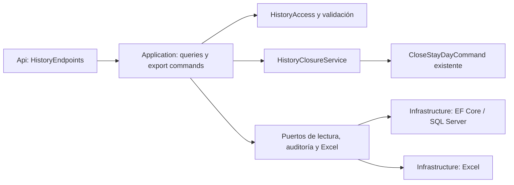

# DESIGN-005 — Consulta de vehículos e historial

| Campo | Valor |
| --- | --- |
| Requerimiento | [RF-005](../requirements/RF-005-vehicle-history-and-search.md), prioridad Media; eventos LPR como consulta principal |
| Estado | Backend y OpenAPI implementados; verificaciones y límites registrados en TASKS-005 |
| Fecha | 19 de noviembre de 2026 |
| Plataforma | C# 14, .NET 10, ASP.NET Core, MediatR, FluentValidation, EF Core y SQL Server |
| Dependencias | RF-001, RF-002, RF-003, RF-004 y RF-009 |
| Decisiones de usuario | P005-01 y P005-02 resueltas en sección 13 |
| Plan | [TASKS-005](../tasks/TASKS-005-vehicle-history-and-search.md), 24 tareas con registro de implementación y verificación |

## 1. Alcance y base inspeccionada

RN, CA y CP sin prefijo pertenecen a RF-005. Este documento diseña consultas,
exportaciones y auditoría de acceso. Su implementación y las pruebas realmente
ejecutadas se registran en TASKS-005; el texto del diseño por sí solo no acredita
verificaciones. No modifica las reglas de interpretación de RF-004.

| Base existente | Uso y límite |
| --- | --- |
| `ICurrentUserContext`, `IAuthenticationSessionRepository`, asignación local | Resolver actor, sesión y taller confiables. No reutilizar `UserAdministrationAccess`, que exige Administrador. |
| `IStayObservationQuery` | Lector interno por partición con cursor para cálculo; no proporciona total ni salto de página. No publicar directamente. |
| `IObservationAuditQuery` | Lector interno por dispositivo y captura con texto original exacto; no es la auditoría de accesos ni el buscador completo de RF-005. |
| `VehicleStayRow`, `StayObservationAssignmentRow`, `StayLineageRow` | Proyección vigente, asociaciones y procedencia; excluir absorbidas de listados ordinarios. |
| `LprEvents`, `LprObservationLocations`, `LprDeviceLocations` | Eventos originales y ubicación histórica ya fijada; no reinterpretarla con el dispositivo actual. |
| `IStayClosureUnitOfWork`, `CloseStayDayCommand`, `StayDailyClosureWorker` | Reutilizar materialización de cierres mediante Application; conservar orden catálogo → partición y límites de RF-004. |
| `AuthenticationDbContext`, `SqlTransactions` | Mantener el contexto y la infraestructura transaccional; no renombrarlos ni alterar migraciones existentes. |
| `ILprClock`, `IWorkshopCalendar`, `Outcome<T>`, `ApiProblems` | Reutilizar reloj, calendario, resultados y errores seguros. |

RF-003 exige confianza no nula en `[0,1]`, con precisión de hasta ocho
decimales. RF-005 admite `decimal?` en su contrato de lectura y filtro de ausencia;
con el esquema actual ese filtro devuelve cero resultados. No convertir cero
en ausencia ni hacer opcional la confianza de ingesta como parte de RF-005.

## 2. Arquitectura y contratos internos

Domain conserva invariantes y cálculo existentes; no conoce filtros HTTP,
Excel, auditoría SQL ni paginación. Application orquesta autorización,
normalización, cierre, selección y registro de acceso mediante MediatR.
Infrastructure contiene consultas, joins, ordenación SQL, mappings, transacciones
y generación Excel. Api transforma DTOs, invoca `ISender` y entrega resultados.
No accede a DbContext ni contiene reglas de solapamiento o presencia.

Tipos nuevos previstos en `GarajeMetria.Application.History`:

| Contrato | Responsabilidad |
| --- | --- |
| `SearchLprEventsQuery`, `SearchStaysQuery`, `ListPresentVehiclesQuery` | Listados paginados autorizados. |
| `GetLprEventQuery`, `GetStayQuery`, `ListStayObservationsQuery` | Detalles acotados y observaciones paginadas, sin heredar filtros del listado de origen. |
| `GetVehicleTimelineQuery` | Cronología combinada para una matrícula exacta. |
| `ListHistoryDevicesQuery`, `ListHistoryLocationsQuery` | Selectores paginados autorizados con elementos históricos. |
| `ExportHistoryCommand` | Mismo filtro y orden del listado, sin paginación; registra una exportación, no una consulta adicional ficticia. |
| `HistoryAccess` | Resuelve y revalida sesión, rol y talleres; devuelve `HistoryScope` inmutable construido por servidor. |
| `IHistoryReadSession` | Ejecuta lecturas materializadas y recuentos en una unidad de lectura coherente, incluida revalidación de acceso. No expone transacciones SQL a Application. |
| `IHistoryQuery` | Proyecciones de eventos, estancias, recorrido, detalle, selectores y detección de cierres vencidos dentro de la sesión de lectura activa. |
| `IHistoryClosureDiscovery` | Páginas de particiones autorizadas con trabajo vencido relevante para la consulta, sin cargar todo el historial. |
| `IHistoryAccessAuditStore` | Persiste una entrada y sus talleres de forma atómica, confirmando commit antes de entregar datos. |
| `IHistoryWorkbookWriter` | Recibe hasta 10.000 DTOs y metadatos seguros; devuelve contenido binario desechable. Sin tipos de librería Excel en Application. |

Los nombres identifican los contratos del tramo RF-005. Puertos
de lectura dedicados sustituyen repositorios de entidades para reporting, según
AGENTS.md. Devuelven DTOs materializados, nunca `IQueryable` o tipos EF.
Contexto y repositorios scoped; handlers transient. No ejecutar tareas simultáneas
con el mismo DbContext. Validadores asíncronos preceden handlers y persistencia;
autorización se revalida en la unidad de lectura y antes de liberar el resultado.

## 3. Contrato HTTP propuesto

Usar Minimal APIs como la base actual, bajo autenticación de usuario RF-001 y
política `HistoryReader` (Administrador o Asesor). No aceptar esquema OAuth de
dispositivo. No modificar `POST /api/lpr/events` ni su JSON snake_case.
Los contratos nuevos usan camelCase y enums string de una allowlist.

| Método y ruta | Operación |
| --- | --- |
| `GET /api/lpr/events` | Buscar eventos. |
| `GET /api/lpr/events/{eventId:guid}` | Detalle de evento. |
| `GET /api/stays` | Historial por solapamiento. |
| `GET /api/stays/{stayId:guid}` | Resultado actual o resolución de identidad absorbida. |
| `GET /api/stays/{stayId:guid}/observations` | Todas las observaciones asociadas, paginadas. |
| `GET /api/vehicles/present` | Estancias abiertas vigentes; una fila por estancia activa. |
| `GET /api/vehicles/timeline` | Recorrido con `plate` exacta y período acotado. |
| `GET /api/history/devices` | Dispositivos disponibles en el ámbito autorizado. |
| `GET /api/history/locations` | Versiones históricas de ubicación disponibles. |
| `POST /api/history/exports` | Exportación Excel síncrona con JSON `{ kind, filters, order }`. |

`kind`: `events`, `stays`, `present`, `timeline`. La búsqueda exacta/parcial se
ofrece en eventos, estancias y presencia; no crear un catálogo ficticio de
vehículos con datos maestros que el sistema no posee. El recorrido exige exacta.
Filtros y valores son datos sensibles: evitar su captura en logs de URL, query,
cuerpos, telemetría de peticiones, proxy e IIS según sección 10.

### 3.1. Parámetros y límites

| Grupo | Parámetros |
| --- | --- |
| Comunes | `workshopIds` repetido; `pageNumber=1`, `pageSize=50` (1..200); `order=desc` o `asc`. |
| Búsqueda | `plate`, `plateMatch=exact|contains`; o `originalText`, `originalMatch=exact|contains`. Texto original solo en eventos. |
| Tiempo | `from`, `to` ISO 8601 con offset o `Z`; alternativamente `fromDate`, `throughDate` de tipo fecha local, ambos inclusive en la entrada. No mezclar modalidades. |
| Eventos | `timeBasis=capture|receipt` (capture predeterminado), `deviceIds`, `locationIds`, `direction=entry|exit|unknown`, `plateStatus=valid|invalid`, `association=all|assigned|unassigned`, `confidenceMode=all|range|missing`, `confidenceMin`, `confidenceMax`. |
| Estancias | `state=open|pendingEntry|closed`, `entrySource=observed|inferred|estimated`, `exitSource` equivalente. |
| Selectores | Talleres, dispositivos para ubicaciones, búsqueda textual acotada y paginación; incluir históricos conservados, sin filtrar implícitamente por activo. |

Arrays de talleres, dispositivos y ubicaciones: 100 IDs por parámetro; eliminar
duplicados y rechazar exceso con 400, sin truncar. Omitir talleres para Admin
significa todos; dividir en varias peticiones no concede un ámbito mayor al
Asesor. No limitar internamente el alcance de «todos» a 100 talleres.
Texto de matrícula/original: 1..32 caracteres, igual que la ingesta; no exigir
que un fragmento sea una matrícula completa válida. Ubicaciones son IDs de
versión histórica, no etiquetas actuales; mostrar descripción, dispositivo y
vigencia para distinguir descripciones iguales. Selección múltiple usa OR dentro
de un parámetro y AND entre parámetros.

Validar límites numéricos, enums, IDs no vacíos, campos desconocidos y duplicados
escalares. `plate` y `originalText` son excluyentes. `range` requiere al menos
un límite, `[0,1]`, mínimo ≤ máximo y precisión admitida por RF-003; `missing`
prohíbe límites. Dispositivos/ubicaciones deben pertenecer al ámbito autorizado.
El orden es una allowlist, nunca una expresión de columna enviada por cliente.
Exportación: máximo 32 KiB de JSON UTF-8; rechazar paginación y filtros que no
correspondan a su `kind`. Configuración y límites se validan al arrancar.

### 3.2. Respuestas

`HistoryPage<T>`: `items`, `pageNumber`, `pageSize`, `totalCount` (entero de
64 bits), `totalPages`, `asOfUtc`, `updatedAtUtc`, `timeZone=Atlantic/Canary` y
ventana efectiva `fromUtc`/`toUtc` cuando corresponda. `asOfUtc` fija los cálculos
de vigencia y duración; `updatedAtUtc` indica esta obtención, no última captura.
No implica una snapshot que pueda reutilizarse en peticiones posteriores.
Página superior al total: 200, items vacíos y total exacto. Usar aritmética
comprobada y paginación SQL de offset amplio, sin desbordar un `int` al calcular
el salto; no fingir que un offset imposible equivale a cero.

`LprEventDto`: `eventId`, `plateOriginal`, `plateNormalized` (null si inválida),
`plateStatus`, `capturedAtUtc`, `receivedAtUtc`, `workshop`, `device`, `location`,
`direction` nullable, `confidence` nullable, `stayId` nullable. La ubicación
incluye ID, descripción y procedencia existente (`Unknown`, `AtCapture`,
`LatestKnownForFutureCapture` mapeadas a camelCase), sin inventar localización
cierta para capturas futuras o evidencia histórica desconocida.

`StayDto`: `stayId`, matrícula, taller, `state`, `entry`/`exit` nullable con
instante, fuente y evento de evidencia nullable; `durationSeconds` nullable,
`durationIsEstimated`, `updatedAtUtc`, `revision`. `state=closed` representa
`ClosedProvisional`, nunca cierre inmutable. Mantener resolución temporal de
100 ns en timestamps; duración decimal en segundos sin redondear el cálculo.
Si una captura futura deja la entrada posterior a `asOfUtc`, duración null
con `durationUnavailableReason=futureEntry`, conforme a `GetDurationAt` actual;
no devolver una duración negativa. Sin entrada, motivo `missingEntry`.

Detalle de estancia: `requestedStayId`, `resolvedStayId`, `wasReplaced`,
resultado vigente y enlace autorizado a observaciones. No incluir un array
ilimitado de lecturas: el endpoint paginado las recorre todas. Evento individual
incluye los mismos datos originales, no payloads arbitrarios o rutas de imágenes.
Timeline usa elementos discriminados `event`/`stay` y `occurredAtUtc`.

## 4. Autorización y aislamiento

1. Verificar sesión RF-001 mediante su infraestructura existente; resolver
   usuario local y taller asignado desde persistencia confiable. Un rol del
   cliente no crea un `HistoryScope`.
2. Asesor: ámbito de un taller activo asignado; un ID de taller diferente
   produce 403 sin datos ni total. Admin: resolver selección explícita o todos,
   incluidos inactivos; inexistentes explícitos producen 404.
3. IDs individuales ajenos o inexistentes, incluidos dispositivos y ubicaciones:
   responder 404 indistinguible para evitar revelar recursos. Un fallo de
   catálogo o sesión produce 503, nunca un ámbito vacío que parezca éxito.
4. Aplicar ámbito en la raíz de cada consulta, cada join, conteo y resolución
   de linaje. Comparar identificadores con la identidad ordinal del proyecto,
   no según una collation SQL permisiva.
5. Revalidar sesión y asignación al leer y antes de auditoría/entrega, especialmente
   tras cierres o generación Excel. Un cambio concurrente detectado impide
   entregar el contenido. Conservar las reglas de revocación RF-001/002.

No usar los endpoints administrativos existentes como selectores del Asesor.
Crear proyecciones mínimas de selector con el mismo control de ámbito. El acceso
histórico no reactiva talleres/dispositivos ni autoriza nuevas ingestas.

## 5. Semántica de filtros y calendario

Normalizar búsqueda de matrícula con las mismas reglas de mayúsculas y
separadores de RF-003, sin reclasificar eventos ni corregir caracteres. Comparar
la columna normalizada persistida solo para matrículas válidas. Texto original:
comparación ordinal sensible a mayúsculas, separadores y espacios significativos,
exacta o fragmento literal; aplicable también a eventos válidos. No recortar
silenciosamente el texto original. `%`, `_`, `[` y escapes nunca son comodines
del usuario: parametrizar y escapar en Infrastructure. No confiar en `LIKE`
dependiente del proveedor como definición de negocio.

Normalizar una ventana `[startUtc,endUtc)` en Application con un puerto de
calendario implementado en Infrastructure. Días completos: inicio local del
primero y del siguiente a `throughDate`, convertidos por `IWorkshopCalendar`.
Si no se suministran fechas en eventos, estancias o timeline, usar día actual;
presencia usa `asOfUtc` sin filtro temporal. Observaciones del detalle no se
recortan por el año del listado: se paginan todas las asociadas.

Máximo de un año: comparar el fin local exclusivo con el inicio local
`AddYears(1)`, conservando hora y aplicando ajuste de fin de mes (29 de febrero
→ 28 de febrero del año siguiente). Una selección de 1 de enero a 31 de
diciembre incluye ese año; 366 días no son inválidos por sí solos. No usar
`TimeSpan.FromDays(365)` ni `AddYears` sobre UTC para expresar el máximo local.
La transformación de esa frontera usa las mismas reglas explícitas de offset;
validar por calendario local antes de ejecutar SQL.

No admitir horas locales sin offset en `from`/`to`. El consumidor presenta
hora canaria y obliga a elegir offset cuando la hora se repite; horas locales
inexistentes no pueden confirmarse como entrada válida. Api recibe el instante
inequívoco y devuelve UTC más zona. Fechas sin hora se convierten por calendario,
sin asumir días de 24 horas.

Historial, después de cierre lógico y excluyendo absorbidas:

- Con ambos extremos y duración positiva: `EntryAt < end && ExitAt > start`.
- Abierta: usar `[EntryAt, asOfUtc]` como evidencia actual; incluir si entrada
  cae en la ventana o si su intervalo transcurrido se solapa. Una entrada futura
  se localiza por su instante, sin duración negativa.
- Pendiente sin entrada: incluir si `ExitAt >= start && ExitAt < end`.
- Duración cero: tratar la estancia como punto, incluido si `EntryAt` cae en
  `[start,end)`; no perder una visita registrada por tener extremos iguales.

Filtros por extremo ausente no coinciden con una fuente concreta. Duraciones
proceden de invariantes Domain y del único `asOfUtc`, nunca del reloj por fila.

## 6. Cierre lógico y consistencia de lectura

Las consultas con estado o asociación necesitan proyección vigente. No añadir
cálculo de negocio en SQL ni inferir presencia con un simple `ExitAt IS NULL`.

1. Resolver ámbito y ventana; descubrir trabajo vencido relevante por talleres
   y particiones autorizadas, en páginas. Para presencia incluir también abiertas
   originadas antes del día actual; no buscar solo capturas de hoy.
2. Materializar cada unidad con `CloseStayDayCommand` y la unidad de trabajo
   existente, sin transacciones anidadas ni bloqueos externos mantenidos por el
   lector. Mantener catálogo → partición, políticas históricas, cancelación y
   presupuesto de RF-004. La lectura no activa configuración ni ejecuta una
   proyección inicial administrativa pendiente.
3. Abrir unidad de lectura coherente, fijar `asOfUtc`, revalidar ámbito y comprobar
   otra vez cierres vencidos relevantes. Si aparecieron por medianoche o una
   ingesta, cerrar la sesión y repetir preparación dentro del presupuesto.
4. Si queda trabajo relevante sin consolidar, devolver 503
   `history_projection_pending` con Retry-After; no filtrar silenciosamente filas
   vencidas ni devolver como actuales resultados parciales. El worker puede
   continuar la recuperación entre peticiones; no lanzar fire-and-forget.
5. Leer total y página, o hasta 10.001 filas de exportación, bajo la misma
   transacción de lectura. Tras materializar, cerrar esa transacción antes de
   generar Excel o enviar bytes.

Primera implementación SQL Server: transacción de lectura `Serializable`,
sin `NOLOCK`, para garantizar filas y total coherentes sin exigir habilitar
snapshot en la base corporativa. No reutilizar `SqlTransactions.ExecuteAsync`
si obliga a adquirir bloqueo exclusivo global de catálogo para cada lectura;
añadir implementación dedicada de `IHistoryReadSession`. Revalidaciones y joins
se hacen secuencialmente con el contexto scoped. Mantener la transacción corta;
timeouts y deadlocks devuelven indisponibilidad segura, sin resultados parciales.
Una alternativa snapshot requiere medición y cambio explícito posterior.

El alcance de preparación incluye asociaciones y observaciones de detalle,
también eventos filtrados por recepción cuyo día de captura sea distinto.
Para un filtro de «sin estancia», no descubrir solo particiones ya asociadas.
Las inválidas no tienen partición fabricada y permanecen consultables.
Tras una ingesta confirmada no exponer mitades de un recálculo; RF-004 ya
persiste proyección y asociaciones en la transacción del evento.

## 7. Proyecciones, ordenación e índices

Consultar `LprEvents` como raíz de eventos, con left joins de ubicación y
asociación por evento y taller; nunca inner join de estancia que descarte
inválidas/sin asociación. No unir todas las revisiones históricas y multiplicar
filas. Resolución de ubicación usa la referencia persistida, incluida procedencia
desconocida; no elegir retrospectivamente la ubicación actual.

Eventos: `(CapturedAt, EventOrderKey)` descendentes por defecto, ambos invertidos
para ascendente, incluso con filtro por recepción. Reutilizar `EventOrderKey`
de UUID canónico; no ordenar por GUID nativo del proveedor. Estancias y presencia:
`COALESCE(EntryAt,ExitAt)` descendente y clave canónica de StayId como desempate;
ascendente invierte ambas. Timeline: instante del evento o entrada de estancia
(salida si falta entrada), tipo (`event` antes de `stay`) y UUID canónico,
ascendente por defecto. Una estancia y su lectura son elementos distintos;
no deduplicar uno por el otro ni confundir total de elementos con vehículos.
Selectores ordenan descripción, dispositivo y clave estable. Nombres actuales
de taller/dispositivo son etiquetas, no evidencia histórica de cambio de nombre.

Filtrar antes de contar y paginar; `AsNoTracking` y proyección explícita sin
lazy loading ni N+1. Saltos de página usan offset, coherente con el requisito
de acceso directo; reconocer coste de páginas profundas y búsquedas contains.
Revisar planes reales con datos sintéticos; no añadir buscador externo o Dapper
sin evidencia. La paginación interna de RF-004 sigue siendo keyset.

Migración nueva SQL Server, índices candidatos a validar con planes:

- Eventos por `(WorkshopId, ReceivedAt, EventOrderKey)` para eje recepción;
  revisar índices existentes por captura antes de añadir redundancias.
- Estancias vigentes por `(WorkshopId, State, EntryAt, Id)` y
  `(WorkshopId, ExitAt, Id)`, filtro SQL específico `AbsorbedByStayId IS NULL`
  cuando aporte valor; columnas incluidas solo según medición.
- Asociaciones existentes por `(StayId,EventId)` y ubicación por evento:
  reutilizar; evaluar `(LocationId,EventId)` si el filtro lo requiere.
- Clave canónica de orden de estancia, calculada/mappeada en Infrastructure,
  para desempate coherente con eventos; validar bytes y traducción SQL.

Longitudes y comparación ordinal de talleres/matrículas se mantienen según
mappings actuales. Contains puede requerir recorrido del conjunto temporal
acotado: un índice B-tree no garantiza búsqueda eficiente por subcadena.
No introducir columnas o SQL de proveedor en Application/Domain/HTTP.

## 8. Detalle y resolución de identidades

Listados solo muestran `AbsorbedByStayId == null`. Para un ID absorbido,
seguir el sucesor persistido dentro de la misma partición y ámbito; comprobar
linaje y detectar ciclos/inconsistencias con error interno seguro. No interpretar
una división como redirección a todas las partes: la identidad conservada sigue
representando su parte actual. La consulta devuelve 200 con los campos de
resolución de sección 3.2, sin redirecciones cacheables que queden obsoletas.

Observaciones por ID absorbido incluyen también `requestedStayId` y
`resolvedStayId`; se consultan contra la estancia resuelta. Toda lectura asociada
se pagina sin truncar por filtros de origen. No exponer `ChangesJson`, políticas
internas o historial de revisiones como requisito nuevo de interfaz.

## 9. Exportación Excel

Síncrona y sin almacenamiento permanente de archivos. Seleccionar los mismos
DTOs y orden del listado bajo la unidad de lectura; `Take(10001)` permite
detectar exceso sin cargar el resto. 10.000 filas de datos válidas; 10.001:
422 `history_export_limit_exceeded`, pedir reducir filtros y no crear archivo.
Timeline cuenta ambos tipos de elemento; cada uno ocupa una fila.

Escritor previsto: Open XML SDK estable compatible con .NET 10, dependencia
solo en Infrastructure, versión fijada al implementar tras revisar la gestión
de paquetes del repositorio. No requiere Excel instalado ni automatización COM.
Escribir celdas de matrícula y todo texto externo como cadenas, nunca elementos
de fórmula; sin macros, vínculos externos ni hipervínculos automáticos.

Una hoja `Results`, cabeceras fijas y filtros visuales, más metadatos de
generación y zona sin copiar textos de búsqueda a logs. Columnas corresponden
al listado; timeline usa tipo y columnas opcionales de evento/estancia. Fechas
se exportan como texto ISO local con offset y zona identificada para evitar
ambigüedad en cambios de horario; números y duraciones son celdas numéricas,
ausencias distinguibles de cero. No exportar una columna de ruta de imagen.

Con 10.000 DTOs el contenido se genera en memoria con límite de tamaño de
salida de 32 MiB y cancelación; fallo o exceso devuelve error completo antes
de iniciar respuesta, sin reducir filas. Liberar buffers/streams en todos los
caminos. Revalidar acceso y persistir auditoría después de generar y antes
de entregar. Si no hay confirmación de auditoría, desechar archivo y devolver
503. MIME `application/vnd.openxmlformats-officedocument.spreadsheetml.sheet`,
`Content-Disposition: attachment` con nombre genérico sin matrícula ni usuario.

## 10. Auditoría, fallos y operación

### 10.1. Auditoría persistente

Nuevo almacenamiento separado de la auditoría de correcciones y sesiones:

| Tabla propuesta | Datos y restricciones |
| --- | --- |
| `HistoryAccessAudits` | ID UUID generado por servidor, ActorUserId, instante UTC, operación enum, ScopeKind (`Selected`/`AllAuthorized`), correlación, estado `AuthorizedRelease`, cantidad de filas. PK Id; índices `(OccurredAt,Id)` y `(ActorUserId,OccurredAt,Id)`. |
| `HistoryAccessAuditWorkshops` | AuditId + WorkshopId como PK; FK al acceso y al taller, sin borrados en cascada desde usuario/taller. Registrar el conjunto efectivo, incluidos talleres sin resultados. |

Longitud de WorkshopId 256 como catálogo actual; operación string ASCII ≤64,
correlación ≤128 validada y generada por infraestructura confiable. UTC precisión
7 en SQL Server. Sin columnas de matrícula, texto original, filtros JSON,
URL completa, payload o tokens. Para ámbito «todos», resolver y registrar el
conjunto efectivo completo dentro de la unidad de lectura, no solo talleres con
filas. Tablas nuevas y permisos operativos de escritura/lectura restringidos.

Cada respuesta de listado, detalle, selector o exportación autorizada (también
vacía) se audita antes de liberar datos. Registro y sus talleres se confirman
atómicamente en una transacción corta después de la lectura/generación. Un
registro significa que se autorizó la liberación; no prueba descarga completa
por el cliente. Fallos de autenticación/validación se tratan por diagnóstico
seguro existente; no registrar como acceso entregado.

P005-01: **sin borrado automático por ahora**. No crear limpieza ni heredar
365 días de auditoría de sesiones. Vigilar crecimiento y capacidad; una política
de eliminación futura requiere decisión explícita. No se añaden endpoints de
edición/eliminación de esta auditoría.

P005-02: **fallo cerrado**. Si no se confirma persistencia, 503
`history_audit_unavailable` sin filas ni archivo. Commit incierto: 503
`operation_outcome_unknown`; no afirmar rollback ni reintentar la escritura
ciegamente. ID de auditoría generado una sola vez por operación para evitar
duplicados en recuperación controlada. Un fallo posterior de red puede dejar
auditoría sin entrega; es preferible a datos entregados sin registro.

### 10.2. Errores y límites operativos

| HTTP | Situación/código nuevo cuando corresponde |
| --- | --- |
| 200 | Listado/detalle, vacío válido o archivo completo. |
| 400 | Forma o filtros inválidos, rango > un año, límites/enums desconocidos. |
| 401 | Credenciales/sesión ausentes o finalizadas según RF-001. |
| 403 | Rol no permitido o ámbito de talleres ajeno solicitado por Asesor. |
| 404 | Recurso individual no visible o inexistente; mismo cuerpo seguro. |
| 413 / 415 | Exportación con cuerpo excesivo o tipo de contenido no admitido. |
| 422 | Más de 10.000 filas para exportar; límite de salida `history_export_size_exceeded`. |
| 429 | Cuota de consulta/exportación; incluir Retry-After. |
| 503 | Dependencia temporal, timeout, proyección pendiente o auditoría no confirmada. |
| 500 | Error inesperado sin detalles internos. |

Reutilizar ProblemDetails y códigos existentes donde sean equivalentes; nuevos
códigos se incorporan a `FailureCode`/mapeo central de manera explícita. No usar
excepciones para resultados esperados ni revelar nombres SQL, stacks o filtros.

Opciones `HistoryOptions` validadas al inicio: página 50/200, exportación 10.000,
cuerpo 32 KiB, salida 32 MiB, timeout total de consulta 30 s, exportación 60 s,
comando SQL 15 s limitado por tiempo restante. Los límites funcionales no son
configurables al alza sin actualizar RF-005. Cuotas iniciales por usuario:
60 consultas/minuto y 5 exportaciones/minuto, 1 exportación concurrente por
usuario y 2 por instancia. Aplicar antes de trabajo costoso; cuotas compartidas
entre instancias con almacén existente cuando proceda, leases de concurrencia
con expiración. No capturar DbContext scoped en un singleton.

API responde `Cache-Control: no-store` en datos y errores; no cachear por CDN.
Usar HTTPS y CORS existente. La autenticación bearer actual no introduce un
flujo cookie nuevo. Propagar `RequestAborted` a lectura, cierres y escritor;
ningún trabajo de exportación sobrevive de forma no supervisada a la petición.

Revisar configuración IIS/proxy/APM para no almacenar query strings de estas
rutas: en logs de aplicación usar nombre de operación y ruta plantilla, nunca
`Request.GetDisplayUrl()`, matrícula en path o bodies de exportación. No añadir
DTOs sensibles como propiedades estructuradas ni permitir `ToString()` que los
serialice; seguir los overrides seguros existentes.
Métricas sin IDs/matrículas: duración por operación/resultado, filas, rechazos
por límites, trabajo de cierre pendiente, fallo de auditoría y exportaciones
concurrentes. Health no devuelve datos personales ni contenidos de filtros.

## 11. Migraciones y entrega

Nueva migración versionada para auditoría, sus relaciones y los índices
justificados. No modificar migraciones aplicadas ni usar EnsureCreated.
Revisar bloqueo y coste de creación de índices en entorno aislado. Aplicación
manual controlada según runbook de migraciones, nunca al arranque productivo.
Rollback no debe eliminar auditoría generada sin plan de conservación; preferir
desactivar rutas y revertir código manteniendo tablas. No implementar borrado
de eventos o imágenes en esta migración.

Actualizar OpenAPI/Swagger UI con filtros, defaults, límites, ejemplos sintéticos,
enums, resolución de IDs, errores y respuesta binaria. Ejemplos HTTP y runbook
deben cubrir permisos, medianoche, búsqueda inválida, salto de página,
exportación excesiva y fallo de auditoría, sin datos productivos. No se crea
funcionalidad por redactar este diseño. El plan de implementación y verificación
se recoge en [TASKS-005](../tasks/TASKS-005-vehicle-history-and-search.md).

## 12. Estrategia de verificación y trazabilidad

| RF-005 CA/CP | Verificación prevista |
| --- | --- |
| 001 | Application con identidades stub y HTTP WebApplicationFactory; Asesor/Admin/dispositivo, detalle/selectores/Excel/total sin fugas y revocación concurrente. |
| 002–004 | SQL Server aislado con lecturas válidas/invalidas/repetidas/sin asociación, left joins sin pérdidas, contains literal y comparación ordinal, filtros múltiples y ubicación histórica. |
| 005–007 | Unitarias de validación/calendario con reloj determinista; integración SQL de captura/recepción, decimal cero/ausencia de resultados missing, DST, horas con offset, año bisiesto y fronteras exactas. |
| 008–010 | Unitarias de solapamiento, presencia y duración (incluida futura y cero); SQL/HTTP de cierre antes de worker, timeout pendiente y asociaciones vigentes sin cambiar RF-004. |
| 011–012 | Timeline mixta y orden canónico con capturas simultáneas; SQL de total+filas bajo ingesta concurrente, salto y páginas profundas, arrays/límites/offset sin overflow. |
| 013–014 | SQL/HTTP de fusión encadenada, división, IDs absorbidos, actualización manual y dispositivos/talleres inactivos; ninguna promesa de snapshot entre páginas. |
| 015–016 | Excel de las cuatro consultas, 10.000/10.001, varias páginas, orden, textos con ceros y signos de fórmula, offsets DST, cancelación y descarte sin archivo parcial. Inspeccionar estructura Open XML y apertura de muestra. |
| 017 | Auditoría atómica de actor/operación/talleres incluso resultados vacíos; fallo y commit incierto impiden entrega; no limpieza automática; logs, IIS de ensayo y telemetría sin filtros sensibles. |

Arquitectura: comprobar dependencias, endpoints sin DbContext, puertos sin
`IQueryable`, proveedor/Excel exclusivamente en Infrastructure. Unitarias de
Application con stubs, sin DB/red; persistencia únicamente con SQL Server
aislado, nunca EF InMemory/SQLite. Ensayos de carga sintética para un año,
total exacto, contains, todos los talleres y competencia ingesta/cierre; registrar
latencias/planes/bloqueos reales antes de ajustar índices o cuotas. No declarar
un SLA de rendimiento sin evidencia.

Al implementar, aplicar la frecuencia de suites de AGENTS.md: consultar registro
local diario, ejecutar pruebas focalizadas y no repetir suite completa sin
autorización. Para este diseño documental solo se revisan coherencia, enlaces
y diff; ninguna prueba de aplicación se presenta como ejecutada.

## 13. Decisiones y límites

| ID | Decisión | Estado |
| --- | --- | --- |
| P005-01 | Conservar auditoría sin borrado automático por ahora; no heredar plazos de sesiones. | Resuelta por usuario el 19/11/2026. |
| P005-02 | Si falla la persistencia de auditoría, bloquear consulta/exportación y devolver 503 sin datos. | Resuelta por usuario el 19/11/2026. |

Las demás elecciones de este documento son decisiones técnicas: contratos
de lectura específicos, horas con offset, fronteras locales, texto original
ordinal, lectura Serializable, Excel síncrono y límites operativos iniciales.
No quedan decisiones funcionales necesarias para redactar el diseño. La
retención definitiva de auditoría queda aplazada expresamente y no bloquea una
implementación sin borrado. El plan de tareas está redactado en TASKS-005.
La implementación, mediciones y pruebas efectivas se registran en TASKS-005;
la validación operativa de logs del alojamiento corporativo sigue siendo externa.

### 13.1. Correspondencia con la implementación

`Application.History.HistoryService` concentra la orquestación de lectura,
exportación y cierre que el diagrama denomina `HistoryClosureService`; no se
añade un servicio separado sin otra responsabilidad. Queries y command se
mantienen como entradas MediatR independientes y `HistoryValidationBehavior`
aplica el validador FluentValidation común antes de ejecutar los handlers.
Los lectores internos RF-004 conservan sus contratos.

`HistoryStore` implementa sesión de lectura, catálogo, descubrimiento y auditoría;
`HistoryQuery` implementa proyecciones sin cargar todo el historial.
`IHistoryAdmission`/`HistoryAdmission` implementan cuota compartida y lease SQL
por usuario; `HistoryInstanceGate` limita exportaciones por instancia.
La migración `20261119090322_VehicleHistoryQueries` añade auditoría, leases,
orden canónico e índices. Su Down rechaza retirar auditoría existente.

EF Core 10 permite forzar colecciones con `EF.Parameter`: se usa en el ámbito
de talleres y en la recuperación por IDs de offsets grandes para evitar miles
de parámetros escalares. Las páginas ordinarias y exportaciones recuperan su
detalle mediante la selección paginada como subconsulta SQL, sin reenviar
10.000 IDs como JSON con una estimación de cardinalidad pequeña.
La paginación de offsets superiores a Int32
se mantiene en Infrastructure mediante comando de la proyección ordenada y
parámetro Int64. Los selectores rechazan un offset no representable si hay
resultados por encima de ese límite, sin desbordar ni retornar la página inicial.

El Excel se genera con Open XML SDK 3.1.1, solo en Infrastructure. La respuesta
de evento individual añade `asOfUtc`/`updatedAtUtc`; OpenAPI distingue eventos,
estancias, selectores, timeline y respuesta binaria. El medidor de historial
registra operación, resultado, duración, filas y solicitudes de exportación
activas, sin identificadores personales como etiquetas.
